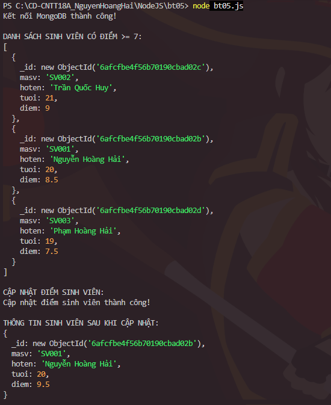

# BÀI 05 - TRUY VẤN VÀ CẬP NHẬT DỮ LIỆU MONGODB

## 1. Mục tiêu

- Sử dụng collection students của database qlsinhvien.

- Tìm sinh viên có điểm lớn hơn hoặc bằng 7.

- Sắp xếp điểm theo thứ tự giảm dần.

- Cập nhật điểm sinh viên bằng updateOne() và $set.

- Kiểm tra thông tin sinh viên sau khi cập nhật.

## 2. Các lệnh MongoDB sử dụng

### Tìm sinh viên có điểm >= 7

```javascript

collection.find({

    diem: { $gte: 7 }

});

```

### Sắp xếp điểm giảm dần

```javascript

.sort({ diem: -1 })

```

### Cập nhật điểm sinh viên

```javascript

collection.updateOne(

    { masv: 'SV001' },

    { $set: { diem: 9.5 } }

);

```

### Kiểm tra sau cập nhật

```javascript

collection.findOne({

    masv: 'SV001'

});

```

## 3. Cài đặt thư viện

```bash

npm install mongodb

```

## 4. Chạy chương trình

```bash

node bai05.js

```

## 5. Kết quả thực hiện

- Kết nối MongoDB thành công.
- Hiển thị danh sách sinh viên có điểm >= 7.
- Danh sách được sắp xếp theo điểm giảm dần.
- Cập nhật điểm sinh viên SV001 thành 9.5.
- Hiển thị thông tin sinh viên sau cập nhật thành công.

## 6. Hình ảnh minh họa

### Kết quả cập nhật

